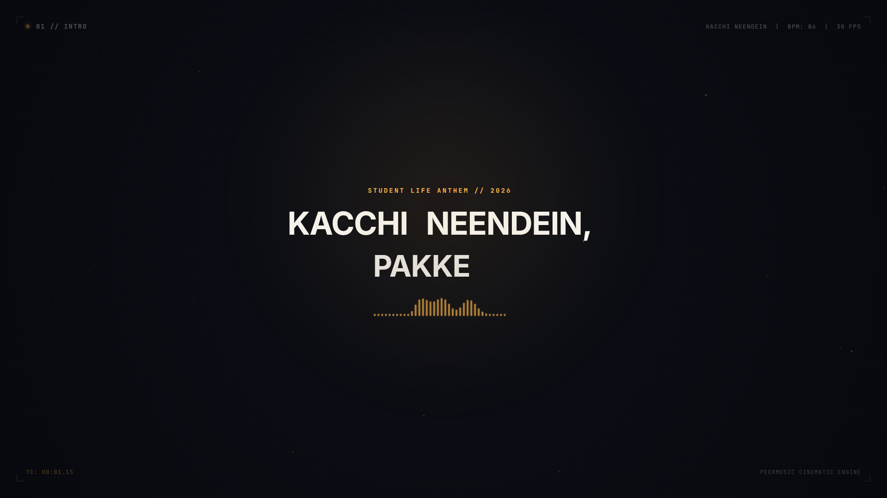
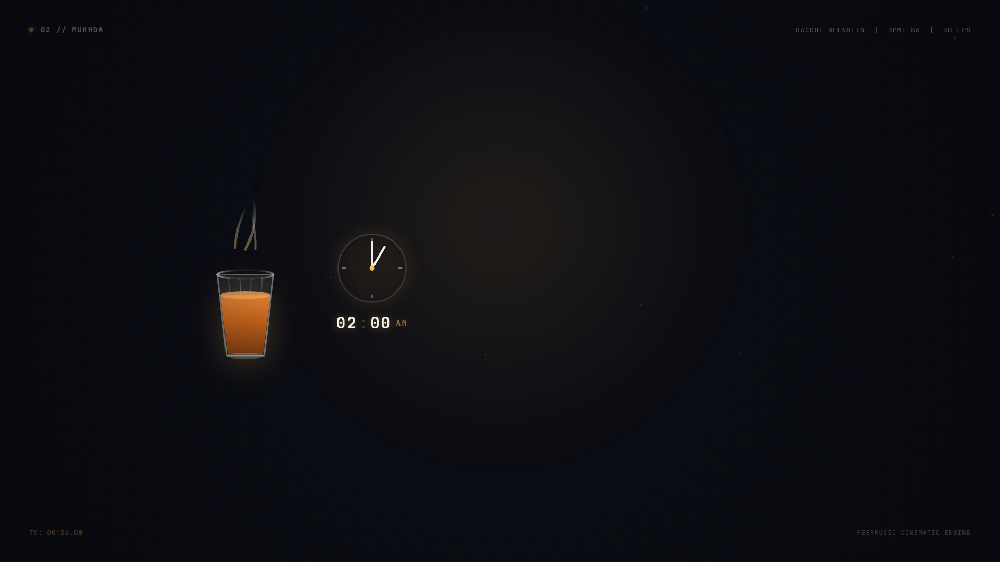
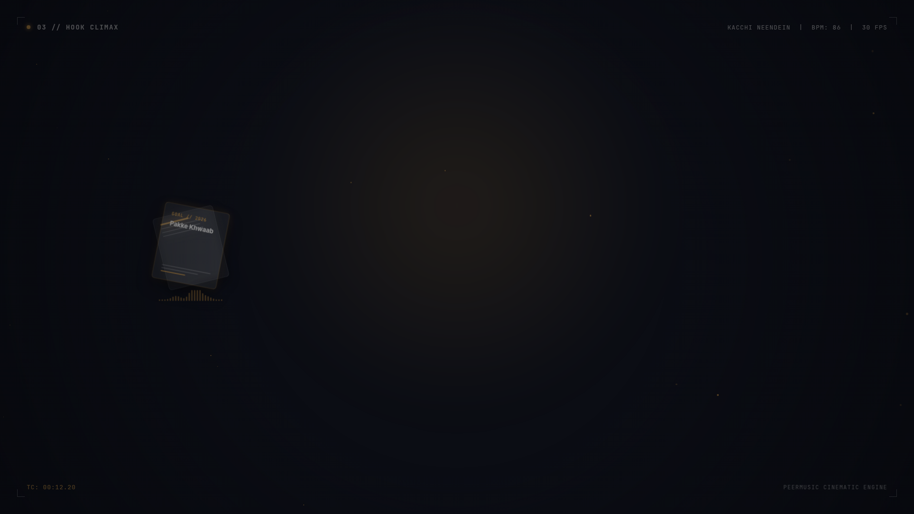
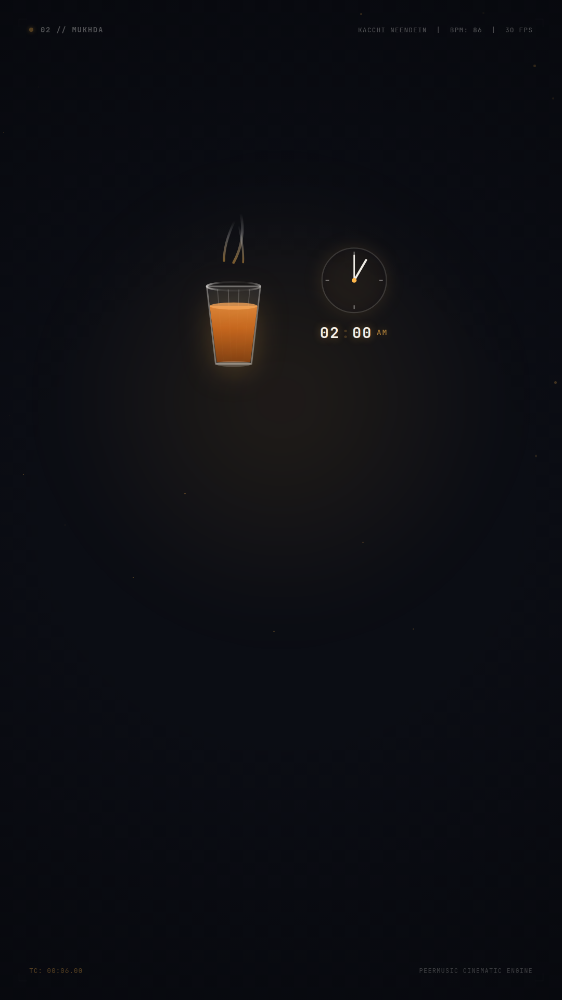

# 🎵 PeerMusic

> **Cinematic Motion Graphics & Symbolic Visual Lyric Video Engine**  
> Powered by **Remotion**, **React**, **TypeScript**, **Whisper**, **Librosa**, and **Antigravity AI Agent Skills**.

---

## 🌟 Overview

**PeerMusic** is a specialized motion design and music video production suite. It elevates lyric videos from simple text displays to **Cinematic Motion Graphics**: pairing synchronized kinetic typography with **symbolic animated visual representations** (visual metaphors, vector scenes, audio-reactive procedural art, dynamic lighting, and camera parallax).

The workflow is built for human-in-the-loop AI music creation across two distinct creative modes:
1. **Direction Confirmation & Intent Detection:**
   - **Mandatory Confirmation**: When language or musical direction is unspecified or ambiguous (e.g. *"Create a beautiful song about school memories"*), the agent **must halt** and ask:
     > **"🎵 What kind of song would you like to create?"**
     > - **🇬🇧 English Song** — English-language song (Indie pop, piano ballad, acoustic pop).
     > - **🇮🇳 Bollywood Song** — Bollywood-style Hindi song (playback, acoustic Hindustani, Sufi).
   - **Intelligent Detection**: If the user explicitly asks for an English song or Bollywood song, the confirmation is bypassed automatically.
   - **Session State**: Preferences are tracked in `scripts/song_session.py` with support for follow-up direction changes before generation.
2. **Profound Poetic Songwriting Engine:**
   - **4-Part Emotional Architecture**: Anchors every song in a surface subject, underlying conflict (contradictions), private unspoken truth, and emotional transformation.
   - **Imply More Than You Explain**: Abandons literal emotional declarations for physical evidence, sensory textures, and unspoken tension.
   - **Mode A: Poetic Bollywood & Hindustani Indie**: Crafts emotionally resonant, singable Hindustani playback lyrics via `bollywood-lyrics-writer`.
   - **Mode B: Profound English Original Songs**: Crafts evocative, professionally written English indie/pop songs with memorable hooks via `english-song-writer`.
   - **Pre-Flight Lyrical Quality Gate**: Audits drafts across 10 quality dimensions using `scripts/songwriting_engine.py`.
3. **Lyrics to Audio (Suno AI):** The agent outputs copy-ready lyrics and tailored musical style prompts directly into the chat for generation in **Suno AI**.
4. **Audio to Motion Graphics Video:** The agent ingests the resulting MP3 audio track and uses **Remotion** to produce an industry-level lyric video combining symbolic visual metaphors, word-level kinetic typography, and 16:9 / 9:16 responsive layouts.

---

## ⚡ The Production Pipeline

```
[ Step 1: User provides Song Request in Chat ]
                         │
                         ▼
┌─────────────────────────────────────────────────────────────┐
│  MANDATORY CONFIRMATION CHECK (scripts/song_session.py)     │
│  • Explicit Direction? ──▶ Proceed directly to Stage 1      │
│  • Ambiguous / Missing? ─▶ STOP & Ask:                      │
│    "🎵 What kind of song would you like to create?"         │
│    🇬🇧 English Song  OR  🇮🇳 Bollywood Song                   │
│  • Wait for User Choice ──▶ Confirm & Transition            │
└──────────────────────────────┬──────────────────────────────┘
                               │
                               ▼
┌─────────────────────────────────────────────────────────────┐
│  STAGE 1: PROFOUND POETIC SONGWRITING & SUNO AI PROMPT      │
│  • 4-Part Emotional Architecture (Subtext, Conflict, Truth) │
│  • 7-Stage Creative Reasoning & 10 Lyrical Quality Gates    │
│  • Mode A: Poetic Bollywood & Hindustani Indie Playback     │
│  • Mode B: Profound English Original Songs (Indie/Ballad)   │
│  • Formatted with Suno-ready tags: [Chorus], [Verse], etc.  │
│  • Audited via `scripts/songwriting_engine.py` for depth    │
│  • Agent provides tailored Suno AI Style Prompt             │
│  • Agent saves lyrics to `lyrics.txt` in workspace          │
└──────────────────────────────┬──────────────────────────────┘
                               │
                               ▼
[ Step 2: User copies lyrics ──▶ Generates song in SUNO AI ──▶ Provides MP3 ]
                               │
                               ▼
┌─────────────────────────────────────────────────────────────┐
│  STAGE 2: AI MUSIC COVER & THUMBNAIL ARTIST                 │
│  • Song-Centric Concept Engine (Original Visual Identity)   │
│  • Dual Formats: 16:9 YouTube Thumbnail & 1:1 Album Cover   │
│  • Quality Benchmark: Atmospheric Depth & Serif/Script Type │
│  • Conformed via `scripts/artwork_pipeline.py` & Synced     │
└──────────────────────────────┬──────────────────────────────┘
                               │
                               ▼
┌─────────────────────────────────────────────────────────────┐
│  STAGE 3: DYNAMIC SONG COVER ARTWORK ENGINE (MP3 + LYRICS)  │
│  • Full-Bleed 16:9 Hero Candid Artwork (`SongCoverBackdrop`) │
│  • Micro-Motion: Ken Burns Slow Push-in & 35mm Dust Particles│
│  • Pure Synced Typography: Subtitles Only (English & Hindi)  │
│  • Zero Clutter: No HUD, No Specimen Cards, No Translations  │
│  • Responsive: 16:9 Landscape & 9:16 Vertical (Reels/Shorts) │
│  • 60 FPS Fluid Standard (`defaultFps: 60`)                  │
│  • Single Universal Visual Engine for ALL Languages          │
└──────────────────────────────┬──────────────────────────────┘
                               │
                               ▼
[ Step 4: Industry-Level Lyrical Music Video & Distribution Package Delivered ]
```

---

## 📸 Remotion Visual Showcase: "Kacchi Neendein, Pakke Khwaab"

Proof of Concept screenshots rendered at 1080p in Remotion across all 3 visual hierarchies and both aspect ratios:

| 01. Scene 1: Atmosphere-Dominant Title (16:9) | 02. Scene 2: Symbolic-Dominant Chai & Clock (16:9) |
| :---: | :---: |
|  |  |
| **03. Scene 3: Typography-Dominant Hook (16:9)** | **04. Scene 2: Mobile Stacked Safe-Zone (9:16 Vertical)** |
|  |  |

---

## 🎨 The 3-Layer Visual Architecture

Every scene in PeerMusic is orchestrated from 3 coordinated layers:

1. **Layer 1: Symbolic Visual Representation (Base)**
   - Custom animated SVG vector illustrations interpreting the poetry.
   - Example: Fluted cutting chai glass with dynamic rising steam curves, glowing 2:00 AM clock dial, floating goal notes.
2. **Layer 2: Kinetic Typography**
   - Word-by-word spring reveals (`spring()`) with overshoot on emotional crests.
   - Curated Swiss typography (Space Grotesk, Inter).
3. **Layer 3: Atmosphere, Camera & Telemetry (Top)**
   - 2.5D continuous camera drift via `CameraRig.tsx`.
   - Procedural 35mm film grain, ambient embers, and vignette.
   - Swiss editorial HUD: timecode readout (`00:04.12`), section tags, and 32-band audio spectrum bars.

---

## 📐 Dynamic Scene Hierarchy

Scenes dynamically shift visual weight to prevent clutter:
- **`ATMOSPHERE_DOMINANT`**: Intros & outros — deep negative space, floating dust, track title.
- **`SYMBOLIC_DOMINANT`**: Narrative verses — prominent animated illustration (Chai & Clock), with lower-third kinetic typography.
- **`TYPOGRAPHY_DOMINANT`**: Chorus hooks — massive spring-loaded typography with warm amber accents, subtle background icon anchor.

---

## 🛠️ Repository Architecture

```
PeerMusic/
├── .agents/
│   └── skills/
│       ├── bollywood-lyrics-writer/
│       │   └── SKILL.md                 # Bollywood songwriting & Suno prompt generator
│       ├── english-song-writer/
│       │   └── SKILL.md                 # Beautiful English songwriting & Suno prompts
│       └── remotion-motion-design/
│           └── SKILL.md                 # Master Remotion motion design skill
├── src/
│   ├── config/
│   │   └── videoConfig.ts               # Configurable FPS (30/60), colors, dimensions
│   ├── engine/                          # ─── REUSABLE GENERIC MOTION ENGINE ───
│   │   ├── types.ts                     # Timeline, Word (unique IDs), Hierarchy schemas
│   │   ├── validation.ts                # Override application & monotonic checks
│   │   ├── typography/                  # KineticPhrase, WordReveal, EditorialHUD
│   │   ├── layout/                      # LandscapeLayout, VerticalLayout, ResponsiveContainer
│   │   ├── camera/                      # CameraRig, FilmAtmosphere
│   │   └── audio/                       # AudioWaveformBars
│   └── songs/                           # ─── SONG CREATIVE ASSETS ───
│       └── kacchi-neendein/
│           ├── timeline.json            # Validated timestamps with unique IDs
│           ├── assets/                  # SteamingChaiGlass, MidnightClock, FloatingNotes
│           ├── scenes/                  # Scene01_IntroTitle, Scene02_ChaiLadaai, Scene03_NeendeinHook
│           └── KacchiNeendeinSong.tsx   # Master multi-scene sequence
├── scripts/
│   └── validate_timeline.py             # CLI validation for timeline.json
├── package.json                         # Remotion 4.x, React 18, Lucide React
└── remotion.config.ts                   # Remotion Chromium config
```

---

## 🚀 Quickstart & Commands

### 1. Install Dependencies
```bash
bun install # or npm install
```

### 2. Validate Timeline Integrity
```bash
python3 scripts/validate_timeline.py src/songs/kacchi-neendein/timeline.json
```

### 3. Interactive Studio Preview
Launch Remotion Studio in your browser:
```bash
npm run dev
# or: npx remotion preview src/index.ts
```

### 4. High-Performance Video Rendering Commands
```bash
# 1. Master Quality Render (CRF 16, Rec.709, 320k Audio)
npm run render

# 2. Maximum Lossless Master (CRF 14, JPEG 98, Concurrency 8)
npm run render:max

# 3. High-Speed Draft Render (3x faster for rapid testing)
npm run render:fast

# 4. Vertical 9:16 Master (Instagram Reels / YouTube Shorts)
npm run render:vertical

# 5. Broadcast Apple ProRes 422 HQ Master (for post-production & grading)
npm run render:prores

# 6. Render Still Frame Previews
npm run still:landscape
npm run still:vertical
```

---

### 5. YouTube Auto-Upload Studio & Metadata Generator

Launch the PeerMusic YouTube Studio web interface to manage channels, edit SEO metadata, and auto-upload rendered videos with custom thumbnails:

```bash
# Launch YouTube Studio (http://localhost:4001)
./start_studio.sh
# or: npm run studio
```

#### Standalone Metadata Generator CLI
```bash
# Auto-generate or update YouTube metadata (Title, Lyrics Description, Tags, Pinned Comment)
python3 scripts/generate_metadata.py
```

---

### 6. AI Music Cover & YouTube Thumbnail Pipeline

Inspect song themes, formulate tailored prompts, and conform dual-format (16:9 & 1:1) artwork:

```bash
# 1. Analyze song and generate tailored 16:9 & 1:1 creative prompts
python3 scripts/artwork_pipeline.py concept kal-tak-jo-roz-ka-tha

# 2. Check artwork and studio thumbnail status across all songs
python3 scripts/artwork_pipeline.py status

# 3. Conform and install generated artwork to out/ and src/songs/<slug>/
python3 scripts/artwork_pipeline.py process --song kal-tak-jo-roz-ka-tha --source <image_path> --format 16x9
python3 scripts/artwork_pipeline.py process --song kal-tak-jo-roz-ka-tha --source <image_path> --format 1x1
```


## 📜 License
MIT License. Created by [phyroosh](https://github.com/phyroosh).
