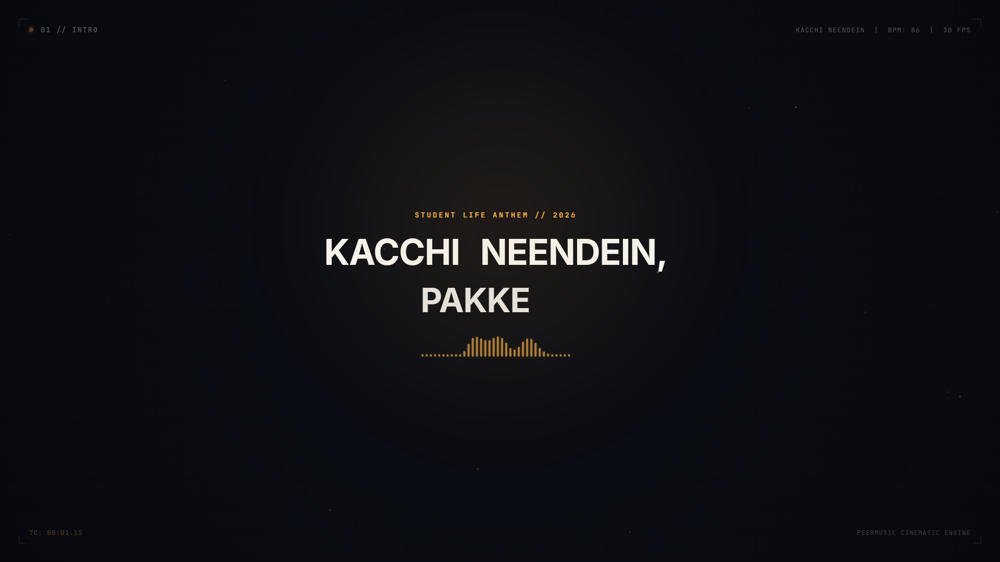
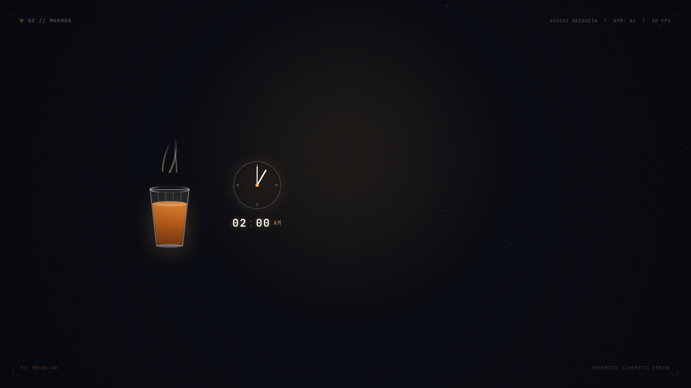
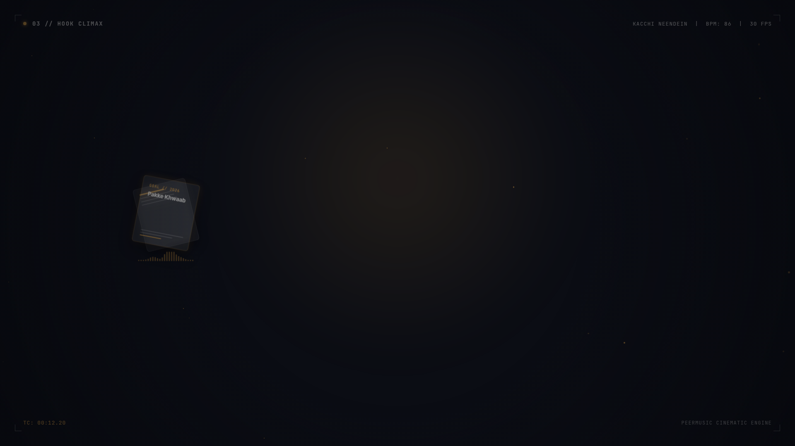
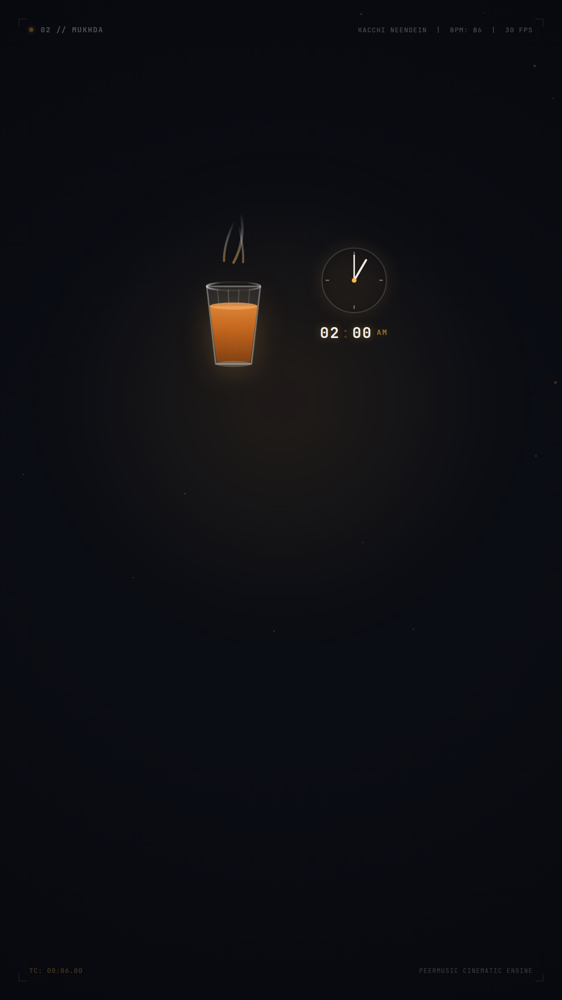

# 🎵 PeerMusic

> **Cinematic Motion Graphics & Symbolic Visual Lyric Video Engine**  
> Powered by **Remotion**, **React**, **TypeScript**, **Whisper**, **Librosa**, and **Antigravity AI Agent Skills**.

---

## 🌟 Overview

**PeerMusic** is a specialized motion design and music video production suite. It elevates lyric videos from simple text displays to **Cinematic Motion Graphics**: pairing synchronized kinetic typography with **symbolic animated visual representations** (visual metaphors, vector scenes, audio-reactive procedural art, dynamic lighting, and camera parallax).

The workflow is built for human-in-the-loop AI music creation:
1. **Topic to Lyrics:** The agent crafts emotionally resonant, singable Bollywood/Hindustani playback lyrics via `bollywood-lyrics-writer`.
2. **Lyrics to Audio (Suno AI):** The agent outputs copy-ready lyrics and tailored musical style prompts directly into the chat for generation in **Suno AI**.
3. **Audio to Motion Graphics Video:** The agent ingests the resulting MP3 audio track and uses **Remotion** to produce an industry-level lyric video combining symbolic visual metaphors, word-level kinetic typography, and 16:9 / 9:16 responsive layouts.

---

## ⚡ The Production Pipeline

```
[ Step 1: User provides Topic / Story / Mood in Chat ]
                         │
                         ▼
┌─────────────────────────────────────────────────────────────┐
│  STAGE 1: LYRICS & SUNO AI PROMPT IN CHAT                   │
│  • Agent writes singable Bollywood/Hindustani lyrics        │
│  • Formatted with Suno-ready tags: [Mukhda], [Antara], etc. │
│  • Agent pastes copy-pasteable lyrics directly in CHAT      │
│  • Agent provides tailored Suno AI Style Prompt             │
│  • Agent saves lyrics to `lyrics.txt` in workspace          │
└──────────────────────────────┬──────────────────────────────┘
                               │
                               ▼
[ Step 2: User copies lyrics ──▶ Generates song in SUNO AI ──▶ Provides MP3 ]
                               │
                               ▼
┌─────────────────────────────────────────────────────────────┐
│  STAGE 2: REMOTION MOTION GRAPHICS ENGINE (MP3 + LYRICS)    │
│  • Generic Engine (`src/engine/`) + Song Assets             │
│  • 3-Layer Visual Architecture:                             │
│    1. Symbolic Visual Representation (Chai glass, Clock)    │
│    2. Kinetic Typography (Spring word reveals, accents)     │
│    3. Polish & Atmosphere (35mm grain, Swiss HUD, camera)   │
│  • Scene-Dependent Hierarchy (Atmosphere / Symbol / Typo)   │
│  • Bespoke Layouts: 16:9 Landscape & 9:16 Vertical          │
│  • Configurable Frame Rate (30 FPS prototype, 60 FPS prod)  │
│  • Dynamic duration derived from timeline                   │
└──────────────────────────────┬──────────────────────────────┘
                               │
                               ▼
[ Step 3: Industry-Level 60 FPS Lyrical Music Video Delivered ]
```

---

## 📸 Remotion Visual Showcase: "Kacchi Neendein, Pakke Khwaab"

Proof of Concept screenshots rendered at 1080p in Remotion across all 3 visual hierarchies and both aspect ratios:

| 01. Scene 1: Atmosphere-Dominant Title (16:9) | 02. Scene 2: Symbolic-Dominant Chai & Clock (16:9) |
| :---: | :---: |
|  |  |
| **03. Scene 3: Typography-Dominant Hook (16:9)** | **04. Scene 2: Mobile Stacked Safe-Zone (9:16 Vertical)** |
|  |  |

---

## 🎨 The 3-Layer Visual Architecture

Every scene in PeerMusic is orchestrated from 3 coordinated layers:

1. **Layer 1: Symbolic Visual Representation (Base)**
   - Custom animated SVG vector illustrations interpreting the poetry.
   - Example: Fluted cutting chai glass with dynamic rising steam curves, glowing 2:00 AM clock dial, floating goal notes.
2. **Layer 2: Kinetic Typography**
   - Word-by-word spring reveals (`spring()`) with overshoot on emotional crests.
   - Curated Swiss typography (Space Grotesk, Inter).
3. **Layer 3: Atmosphere, Camera & Telemetry (Top)**
   - 2.5D continuous camera drift via `CameraRig.tsx`.
   - Procedural 35mm film grain, ambient embers, and vignette.
   - Swiss editorial HUD: timecode readout (`00:04.12`), section tags, and 32-band audio spectrum bars.

---

## 📐 Dynamic Scene Hierarchy

Scenes dynamically shift visual weight to prevent clutter:
- **`ATMOSPHERE_DOMINANT`**: Intros & outros — deep negative space, floating dust, track title.
- **`SYMBOLIC_DOMINANT`**: Narrative verses — prominent animated illustration (Chai & Clock), with lower-third kinetic typography.
- **`TYPOGRAPHY_DOMINANT`**: Chorus hooks — massive spring-loaded typography with warm amber accents, subtle background icon anchor.

---

## 🛠️ Repository Architecture

```
PeerMusic/
├── .agents/
│   └── skills/
│       ├── bollywood-lyrics-writer/
│       │   └── SKILL.md                 # Songwriting & Suno prompt generator
│       └── remotion-motion-design/
│           └── SKILL.md                 # Master Remotion motion design skill
├── src/
│   ├── config/
│   │   └── videoConfig.ts               # Configurable FPS (30/60), colors, dimensions
│   ├── engine/                          # ─── REUSABLE GENERIC MOTION ENGINE ───
│   │   ├── types.ts                     # Timeline, Word (unique IDs), Hierarchy schemas
│   │   ├── validation.ts                # Override application & monotonic checks
│   │   ├── typography/                  # KineticPhrase, WordReveal, EditorialHUD
│   │   ├── layout/                      # LandscapeLayout, VerticalLayout, ResponsiveContainer
│   │   ├── camera/                      # CameraRig, FilmAtmosphere
│   │   └── audio/                       # AudioWaveformBars
│   └── songs/                           # ─── SONG CREATIVE ASSETS ───
│       └── kacchi-neendein/
│           ├── timeline.json            # Validated timestamps with unique IDs
│           ├── assets/                  # SteamingChaiGlass, MidnightClock, FloatingNotes
│           ├── scenes/                  # Scene01_IntroTitle, Scene02_ChaiLadaai, Scene03_NeendeinHook
│           └── KacchiNeendeinSong.tsx   # Master multi-scene sequence
├── scripts/
│   └── validate_timeline.py             # CLI validation for timeline.json
├── package.json                         # Remotion 4.x, React 18, Lucide React
└── remotion.config.ts                   # Remotion Chromium config
```

---

## 🚀 Quickstart & Commands

### 1. Install Dependencies
```bash
bun install # or npm install
```

### 2. Validate Timeline Integrity
```bash
python3 scripts/validate_timeline.py src/songs/kacchi-neendein/timeline.json
```

### 3. Interactive Studio Preview
Launch Remotion Studio in your browser:
```bash
npm run dev
# or: npx remotion preview src/index.ts
```

### 4. Render Still Frames
```bash
# 16:9 Landscape Still (Frame 180 - Chai & Clock Scene)
npx remotion still src/index.ts KacchiNeendein-Landscape out/landscape_chai.png --frame=180

# 9:16 Vertical Still (Frame 180 - Mobile Stacked Layout)
npx remotion still src/index.ts KacchiNeendein-Vertical out/vertical_chai.png --frame=180
```

### 5. Render Video
```bash
# Landscape MP4
npm run render:landscape

# Vertical MP4 (Reels / Shorts)
npm run render:vertical
```

---

## 📜 License
MIT License. Created by [phyroosh](https://github.com/phyroosh).
