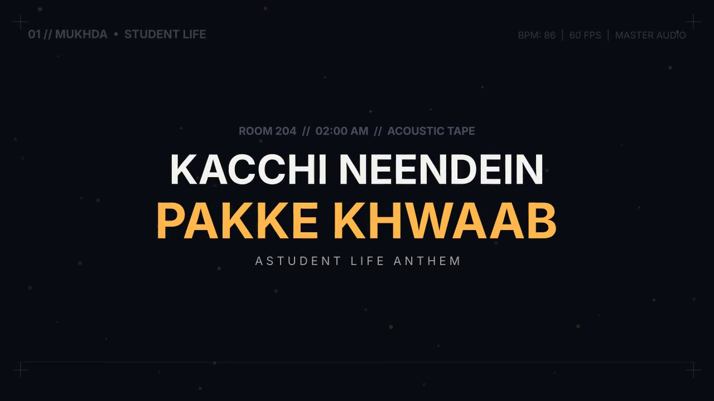
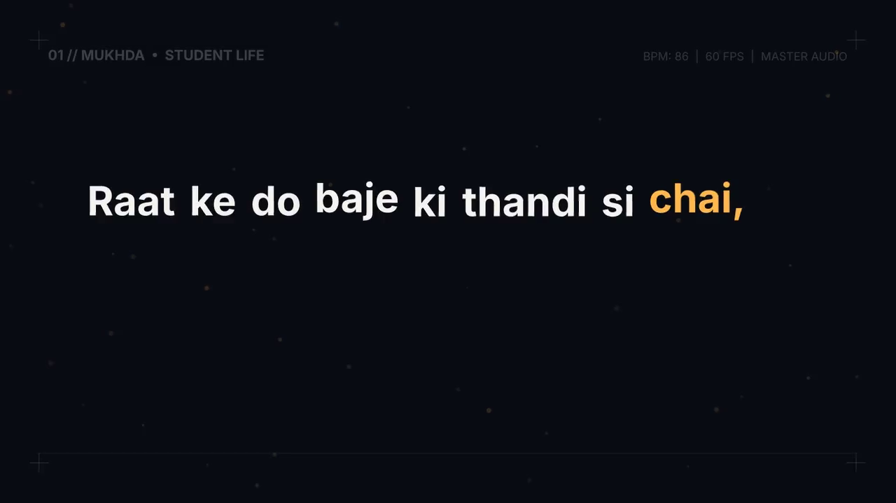
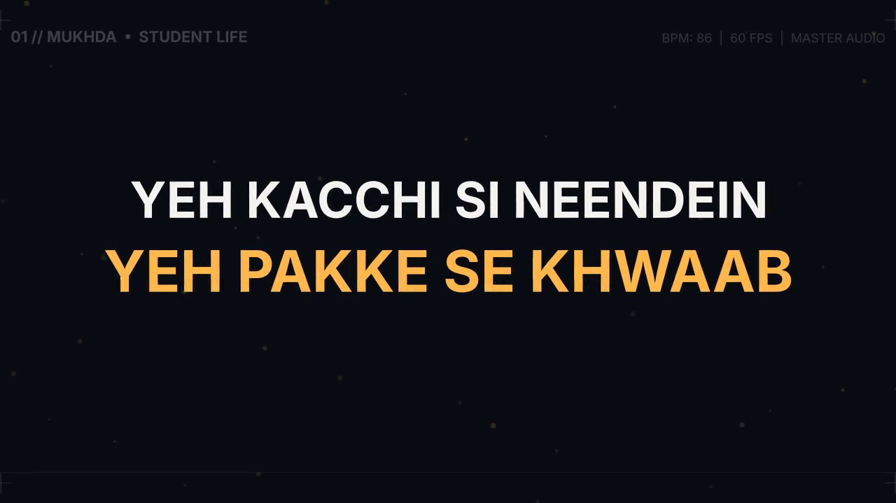
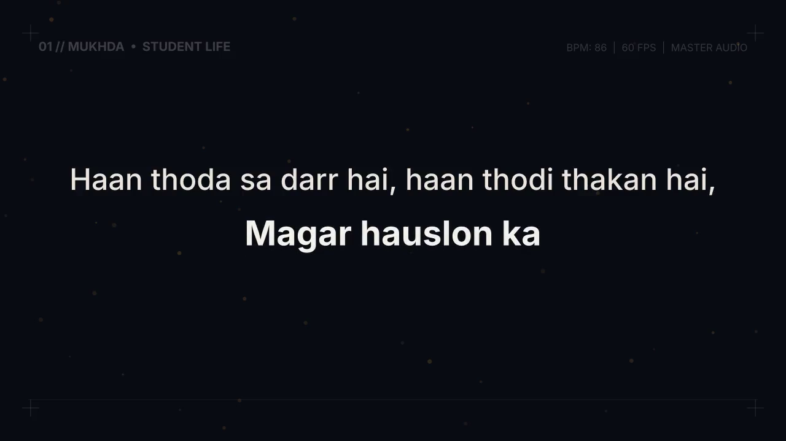

# 🎵 PeerMusic

> **Industry-Grade Lyrical Motion Design & AI Songwriting System**  
> Powered by **Manim**, **Python**, **Whisper**, **Librosa**, and **Antigravity AI Agent Skills**.

---

## 🌟 Overview

**PeerMusic** is a specialized computational animation and music video production suite. It bridges original song creation with Swiss-minimalist, 60 FPS kinetic typography.

The system is architected around a human-in-the-loop workflow:
1. **Topic to Lyrics:** The agent crafts emotionally resonant, singable Bollywood/Hindustani playback lyrics via `bollywood-lyrics-writer`.
2. **Lyrics to Audio (Suno AI):** The agent pastes copy-ready lyrics and tailored musical style prompts directly into the chat for generation in **Suno AI**.
3. **Audio to 60 FPS Video:** The agent ingests the resulting MP3 audio track and uses `manim-lyric-motion` to produce an award-winning lyric video using custom Bézier physics, camera choreography, and sub-millisecond audio sync.

---

## ⚡ The Production Pipeline

```
[ Step 1: User provides Topic / Story / Mood in Chat ]
                         │
                         ▼
┌─────────────────────────────────────────────────────────────┐
│  STAGE 1: LYRICS & SUNO AI PROMPT IN CHAT                   │
│  • Agent writes singable Bollywood/Hindustani lyrics        │
│  • Formatted with Suno-ready tags: [Mukhda], [Antara], etc. │
│  • Agent pastes copy-pasteable lyrics directly in CHAT      │
│  • Agent provides tailored Suno AI Style Prompt             │
│  • Agent saves lyrics to `lyrics.txt` in workspace          │
└──────────────────────────────┬──────────────────────────────┘
                               │
                               ▼
[ Step 2: User copies lyrics ──▶ Generates song in SUNO AI ──▶ Provides MP3 ]
                               │
                               ▼
┌─────────────────────────────────────────────────────────────┐
│  STAGE 2: MANIM KINETIC MOTION ENGINE (MP3 + LYRICS)        │
│  • Agent ingests the Suno MP3 audio file                    │
│  • Runs Whisper word-level alignment (transcribe_sync.py)   │
│  • Runs Librosa BPM & beat transient detector               │
│  • Selects locked Visual Archetype (Swiss / Sufi / Cyber)   │
│  • Authors modular MovingCameraScene classes in Manim       │
│  • Renders at 60 FPS and losslessly muxes original Suno MP3 │
└──────────────────────────────┬──────────────────────────────┘
                               │
                               ▼
[ Step 3: Industry-Level 60 FPS Lyrical Music Video Delivered ]
```

---

## 📸 Visual Previews: "Kacchi Neendein, Pakke Khwaab"

Sample renders generated via the **Cinematic Midnight & Sufi Soul** archetype:

| 01. Title & Editorial HUD | 02. Word-by-Word Reveal ("2 AM Chai") |
| :---: | :---: |
|  |  |
| **03. Rhythmic Hook Snap** | **04. Vocal Climax Highlight** |
|  |  |

---

## 🎨 4 Elite Visual Archetypes

| Archetype | Genre & Mood | Palette | Typography & Motion |
| :--- | :--- | :--- | :--- |
| **Swiss Brutalist Kinetic** | Desi Hip-Hop, Pop Anthem, Club | `#0D0E12` Obsidian, `#CCFF00` Volt Lime, Stark White | *Cabinet Grotesk*, *Inter Black*, *Mukta ExtraBold*. Aggressive Bézier snap (`EASE_OUT_EXPO`), HUD overlays. |
| **Cinematic Midnight & Sufi Soul** | Romantic Ballad, Acoustic Playback | `#0B0D14` Indigo, `#FFB84C` Royal Amber, Ivory | *Rozha One*, *Cinzel*, *Noto Serif Devanagari*. Slow breathing camera drift, floating ambient embers. |
| **Neo-Techno Pulse & Cyber-Y2K** | Trap Fusion, EDM, Modern Club | `#08040E` Violet, `#00F5FF` Cyan, `#FF007A` Magenta | *JetBrains Mono*, *Space Grotesk*, *Yatra One*. Scale bounce on 808s, rapid staggered typewriter reveals. |
| **Organic Monsoon & Nostalgia** | Indie Folk, Rainy Nostalgia | `#F3EFE6` Vintage Paper, `#C85A32` Terracotta | *Lora*, *Kalam*, *Syne*. Harmonic spring physics (`EASE_SPRING`), generous 60% negative space. |

---

## 🛠️ Repository Architecture

```
PeerMusic/
├── .agents/
│   └── skills/
│       ├── bollywood-lyrics-writer/
│       │   └── SKILL.md            # Hindi playback songwriting skill & Suno format
│       └── manim-lyric-motion/
│           └── SKILL.md            # Manim motion design manual & anti-slop rules
├── references/
│   ├── easing_curves.py            # Bespoke Bézier, spring damping & pulse physics
│   ├── motion_primitives.py        # KineticPhrase, MinimalEditorialHUD, camera drift
│   ├── design_archetypes.md        # Comprehensive visual styling guide
│   └── anti_slop_checklist.md      # Mandatory QA review before final render
├── scripts/
│   ├── transcribe_sync.py          # Audio -> Word-level timestamp extractor (Whisper)
│   ├── beat_analyzer.py            # Audio -> BPM & Transient onset detector (Librosa)
│   └── render_pipeline.py          # 60 FPS compiler, scene stitcher & audio muxer
├── examples/
│   └── lyrical_scene_demo.py       # Reference implementation of a Mukhda scene
├── SKILL.md                        # Master root skill documentation
└── README.md                       # Project overview and quickstart
```

---

## 🚀 Quickstart & Usage

### 1. Prerequisites
Ensure you have Python 3.10+, FFmpeg, and Manim installed:
```bash
# System packages (Debian/Ubuntu/Arch)
sudo apt update && sudo apt install ffmpeg libcairo2-dev libpango1.0-dev

# Python dependencies
pip install manim faster-whisper librosa
```

### 2. Audio-Lyric Alignment
Extract word-level timestamps and detect song BPM/transients:
```bash
python3 scripts/transcribe_sync.py path/to/suno_song.mp3 --lyrics lyrics.txt --output lyrics_sync.json
python3 scripts/beat_analyzer.py path/to/suno_song.mp3 --output beats_sync.json
```

### 3. Render at 60 FPS with Lossless Audio Muxing
```bash
python3 scripts/render_pipeline.py examples/lyrical_scene_demo.py \
    --scene MukhdaDemoScene \
    --audio path/to/suno_song.mp3 \
    --quality high \
    --fps 60 \
    --output final_video.mp4
```

---

## 📜 License
MIT License. Created by [phyroosh](https://github.com/phyroosh).
